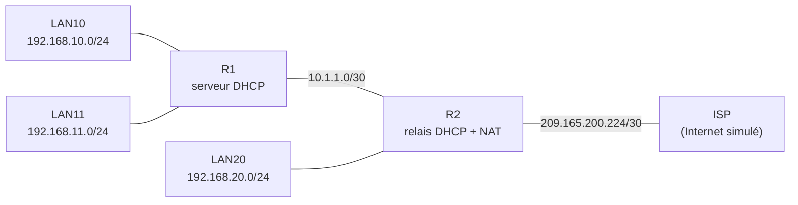
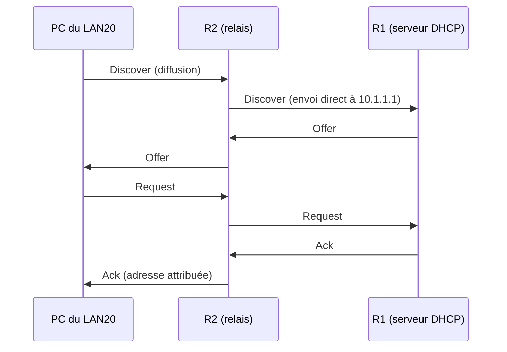

# 📡 DHCP centralisé avec relais

Un routeur **R1** joue le rôle de **serveur DHCP** pour tous les réseaux locaux, y compris celui situé derrière un second routeur **R2**, grâce au **relais DHCP** (`ip helper-address`). Le réseau sort ensuite vers Internet par **R2**, qui fait la traduction d'adresses. Réalisé sous **Cisco Packet Tracer** (TP 7.4.1 à 7.4.3 : configuration, configuration avancée et dépannage).

[⬅ Retour au portfolio](https://github.com/EvanBienvenu/EvanBienvenu)

## Contexte

Configurer l'adresse IP de chaque poste à la main est long et source d'erreurs. Le DHCP automatise cette tâche. Mais une demande DHCP est envoyée en **diffusion**, et une diffusion **ne traverse pas un routeur** : sans relais, il faudrait un serveur DHCP par réseau.

## Objectifs

- Configurer R1 comme serveur DHCP, avec un pool par réseau
- Réserver les adresses fixes (routeurs, serveurs)
- Permettre aux postes du réseau de R2 d'obtenir une adresse auprès de R1
- Assurer le routage entre les réseaux internes et la sortie vers le fournisseur d'accès (ISP)

## Topologie



### Plan d'adressage

| Équipement | Interface | Adresse IP | Masque |
| --- | --- | --- | --- |
| R1 | S0/0/0 | 10.1.1.1 | 255.255.255.252 |
| R1 | Fa0/0 (LAN10) | 192.168.10.1 | 255.255.255.0 |
| R1 | Fa0/1 (LAN11) | 192.168.11.1 | 255.255.255.0 |
| R2 | S0/0/0 | 10.1.1.2 | 255.255.255.252 |
| R2 | S0/0/1 (vers ISP) | 209.165.200.225 | 255.255.255.252 |
| R2 | Fa0/0 (LAN20) | 192.168.20.1 | 255.255.255.0 |
| ISP | S0/0/1 | 209.165.200.226 | 255.255.255.252 |

Le TP 7.4.2 reprend la même logique avec des adresses en `172.16.x.x`.

## Configuration

### R1 : serveur DHCP

```cisco
ip dhcp excluded-address 192.168.10.1 192.168.10.10
ip dhcp excluded-address 192.168.11.1 192.168.11.10
!
ip dhcp pool LAN10
 network 192.168.10.0 255.255.255.0
 default-router 192.168.10.1
 dns-server 8.8.8.8
!
ip dhcp pool LAN11
 network 192.168.11.0 255.255.255.0
 default-router 192.168.11.1
 dns-server 8.8.8.8
!
! R1 est en bout de réseau : une seule route par défaut vers R2
ip route 0.0.0.0 0.0.0.0 10.1.1.2
```

<!-- À vérifier : ajouter ici le pool du LAN20 tel que configuré dans le TP. -->

### R2 : relais DHCP et routage

```cisco
interface fa0/0
 ip address 192.168.20.1 255.255.255.0
 ip helper-address 10.1.1.1
!
! Routes de retour vers les réseaux de R1
ip route 192.168.10.0 255.255.255.0 10.1.1.1
ip route 192.168.11.0 255.255.255.0 10.1.1.1
! Tout le reste vers Internet
ip route 0.0.0.0 0.0.0.0 209.165.200.226
```

### ISP

```cisco
ip route 192.168.0.0 255.255.0.0 209.165.200.225
```

La partie traduction d'adresses (NAT) configurée sur R2 est détaillée dans le projet [Filtrage ACL et NAT/PAT](https://github.com/EvanBienvenu/acl-nat-pat).

## Fonctionnement du relais



## Tests

| Test | Commande | Résultat attendu |
| --- | --- | --- |
| Adresse reçue par un PC | `ipconfig` | Adresse dans la bonne plage, après `.10` |
| Baux distribués | `show ip dhcp binding` (R1) | Une ligne par PC, avec son adresse MAC |
| État des pools | `show ip dhcp pool` (R1) | Adresses distribuées / disponibles |
| Connectivité | `ping 209.165.200.226` depuis un PC | Réponses de l'ISP |

## Dépannage (TP 7.4.3)

Le TP 7.4.3 fournit une configuration volontairement erronée à corriger. Méthode suivie : `show ip interface brief`, puis `show ip route`, puis `show ip dhcp binding`, puis `show ip nat translations`.

| Symptôme | Cause recherchée |
| --- | --- |
| Interface `down` | `no shutdown` manquant |
| PC en `169.254.x.x` | `ip helper-address` absent sur R2 |
| Les réponses ne reviennent pas | Route de retour manquante sur R2 |
| Adresse reçue mais pas de résolution de noms | `dns-server` absent du pool |

## Ce que j'ai appris

- Pourquoi une diffusion s'arrête au routeur, et comment le relais contourne ce problème
- Centraliser un service pour simplifier l'administration
- Penser aux **routes de retour** : sans elles, les réponses ne reviennent pas
- Dépanner méthodiquement une configuration écrite par quelqu'un d'autre

## Compétences mobilisées

[DHCP](https://github.com/EvanBienvenu/competences-reseau/blob/main/04-dhcp.md) · [Routage](https://github.com/EvanBienvenu/competences-reseau/blob/main/02-routage.md) · [NAT et PAT](https://github.com/EvanBienvenu/competences-reseau/blob/main/05-nat-pat.md)

## 📖 Termes techniques

| Terme | Explication |
| --- | --- |
| **DHCP** | Service qui attribue automatiquement une adresse IP aux appareils. |
| **Pool** | Plage d'adresses qu'un serveur DHCP peut distribuer sur un réseau. |
| **Adresse exclue** | Adresse réservée (routeur, serveur) que le DHCP ne distribuera jamais. |
| **Relais DHCP** | Le routeur transmet les demandes DHCP vers un serveur situé sur un autre réseau. |
| **`ip helper-address`** | Commande Cisco qui active le relais DHCP sur une interface. |
| **Diffusion (broadcast)** | Message envoyé à tous les appareils du réseau local. |
| **Bail (lease)** | Durée pendant laquelle un appareil peut utiliser l'adresse reçue. |
| **DORA** | Les 4 étapes du DHCP : Discover, Offer, Request, Acknowledge. |
| **APIPA (169.254.x.x)** | Adresse que Windows se donne lui-même quand aucun serveur DHCP ne répond. |
| **Route par défaut** | Route utilisée pour toute destination inconnue (`0.0.0.0/0`). |
| **ISP** | Fournisseur d'accès à Internet. |

Tous les termes sont aussi expliqués dans le [glossaire du portfolio](https://github.com/EvanBienvenu/EvanBienvenu/blob/main/GLOSSAIRE.md).
