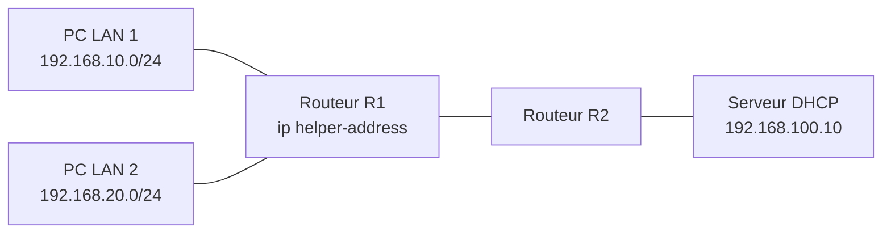
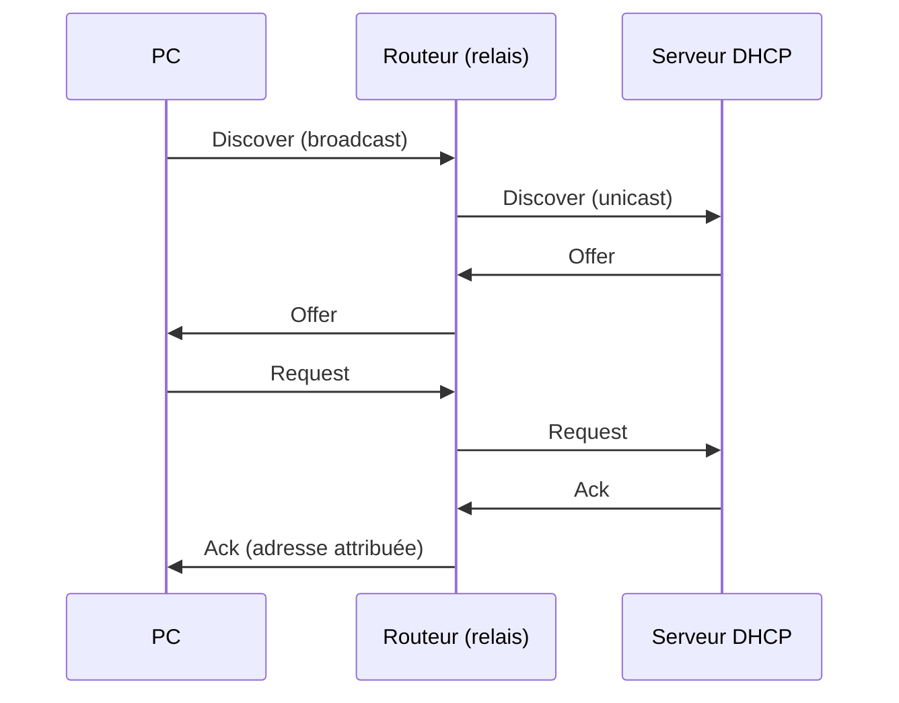

# 📡 DHCP centralisé avec relais

Un **serveur DHCP unique** distribue automatiquement les adresses IP de plusieurs réseaux locaux. Les routeurs relaient les demandes vers ce serveur grâce à la commande Cisco **`ip helper-address`**.

[⬅ Retour au portfolio](https://github.com/EvanBienvenu/EvanBienvenu)

## Contexte

Une demande DHCP est envoyée en *broadcast* (à tout le réseau local) et ne traverse normalement pas les routeurs. Sans relais, il faudrait donc un serveur DHCP par réseau. Le relais DHCP permet de centraliser ce service sur un seul serveur, plus simple à administrer.

## Objectifs

- Installer un serveur DHCP avec une plage d'adresses par réseau
- Configurer le relais DHCP sur les routeurs
- Vérifier que chaque poste reçoit une adresse du bon réseau

## Topologie



<!-- À vérifier : remplacer les adresses par celles de la maquette réelle. -->

### Plages DHCP

| Réseau | Plage distribuée | Passerelle | DNS |
| --- | --- | --- | --- |
| 192.168.10.0/24 | .10 à .200 | 192.168.10.254 | 192.168.100.10 |
| 192.168.20.0/24 | .10 à .200 | 192.168.20.254 | 192.168.100.10 |

## Configuration

### Relais sur le routeur

```cisco
interface GigabitEthernet0/0
 ip address 192.168.10.254 255.255.255.0
 ip helper-address 192.168.100.10
!
interface GigabitEthernet0/1
 ip address 192.168.20.254 255.255.255.0
 ip helper-address 192.168.100.10
```

### Serveur DHCP

Une étendue (plage d'adresses) est créée pour chaque réseau, avec la passerelle et le serveur DNS correspondants. Le serveur reconnaît le réseau d'origine de la demande grâce à l'adresse de l'interface du routeur qui l'a relayée.

## Fonctionnement : le processus DORA



## Tests et vérifications

| Test | Commande | Résultat attendu |
| --- | --- | --- |
| Adresse reçue (Windows) | `ipconfig /all` | Adresse dans la bonne plage |
| Renouvellement | `ipconfig /release` puis `ipconfig /renew` | Nouvelle attribution réussie |
| Baux sur le serveur | Console DHCP | Un bail par poste |
| Connectivité | `ping` vers la passerelle et le serveur | Réponses reçues |

## Ce que j'ai appris

- Comprendre pourquoi un broadcast ne traverse pas un routeur
- Centraliser un service réseau pour simplifier l'administration
- Analyser les quatre étapes d'une attribution DHCP

## 📖 Termes techniques

| Terme | Explication |
| --- | --- |
| **DHCP** | Service qui attribue automatiquement une adresse IP aux appareils. |
| **Relais DHCP** | Le routeur transmet les demandes DHCP vers un serveur situé sur un autre réseau. |
| **`ip helper-address`** | Commande Cisco qui active le relais DHCP sur une interface. |
| **Broadcast** | Message envoyé à tous les appareils du réseau local. |
| **Unicast** | Message envoyé à un seul destinataire précis. |
| **Étendue (scope)** | Plage d'adresses qu'un serveur DHCP peut distribuer sur un réseau. |
| **Bail (lease)** | Durée pendant laquelle un appareil peut utiliser l'adresse reçue. |
| **DORA** | Les 4 étapes du DHCP : Discover, Offer, Request, Acknowledge. |

Tous les termes sont aussi expliqués dans le [glossaire du portfolio](https://github.com/EvanBienvenu/EvanBienvenu/blob/main/GLOSSAIRE.md).
